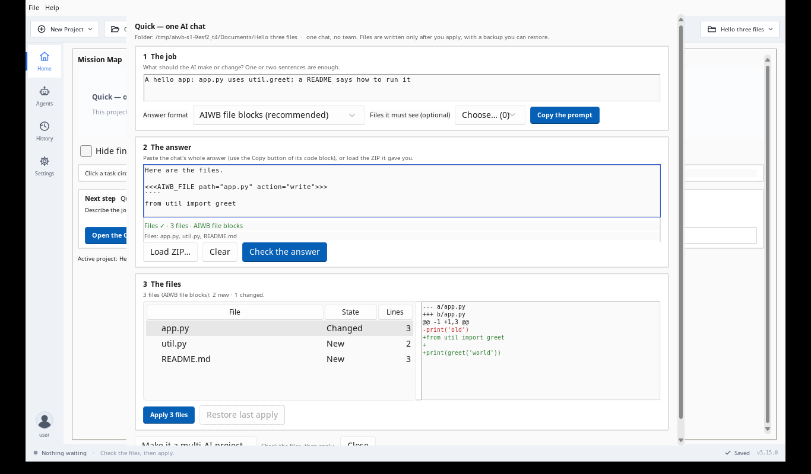
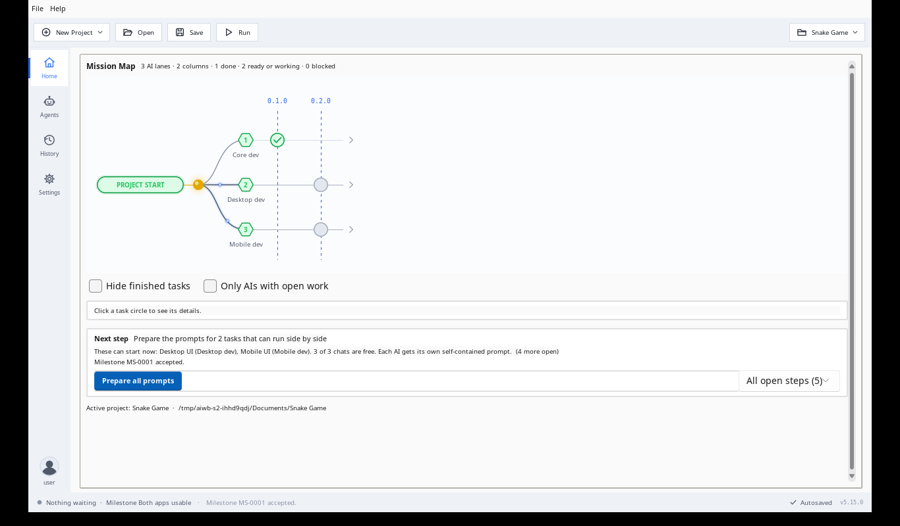
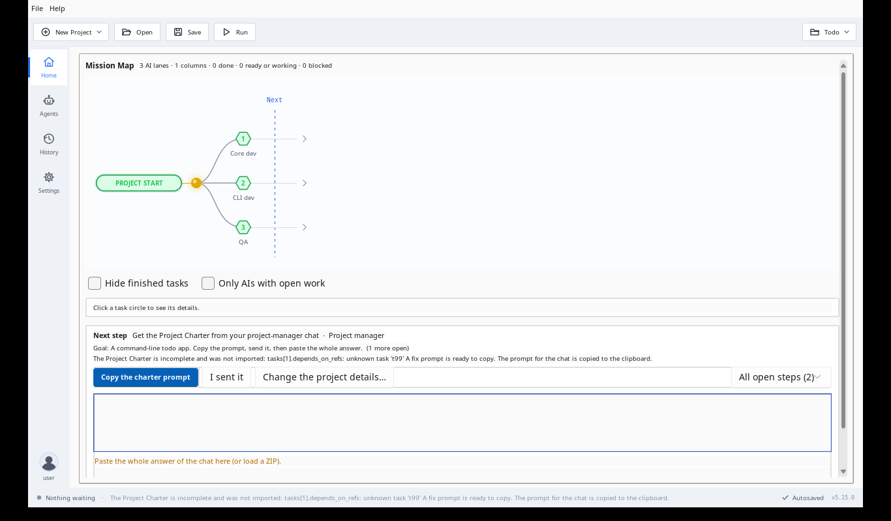
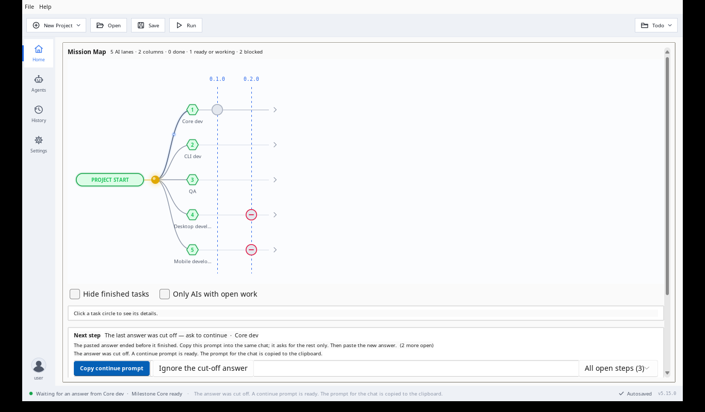
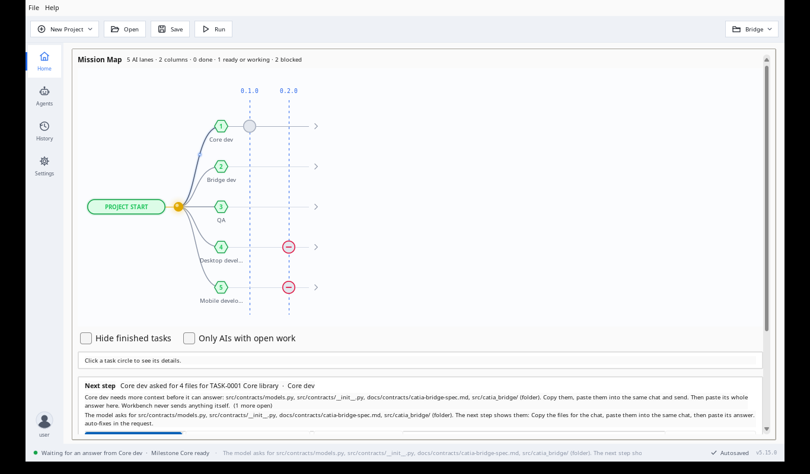
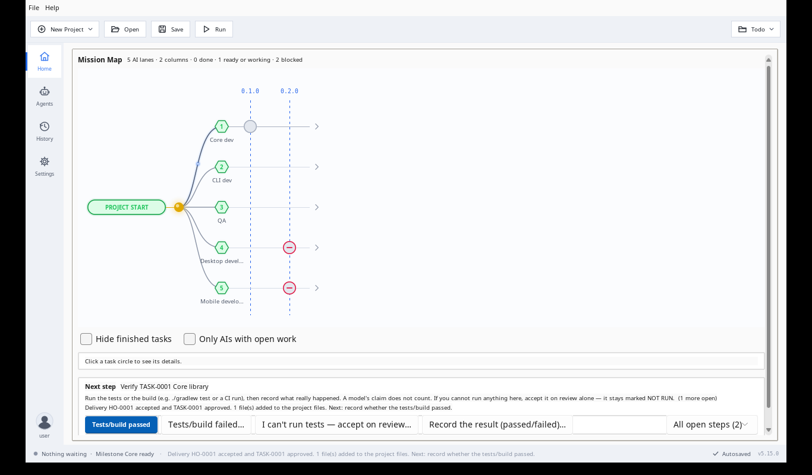

# راهنمای کاربر AI Workbench (دسکتاپ 5.15.0)

AI Workbench به شما کمک می‌کند یک پروژهٔ نرم‌افزاری را با همان چت‌های هوش مصنوعی که همیشه استفاده می‌کنید
(ChatGPT، Gemini، Claude و …) بسازید — **بدون کلید API و بدون ورود به حساب در برنامه**. برنامه با مدل‌ها فقط دو کار
می‌کند:

1. برای شما **یک پرامپت می‌نویسد** تا آن را در چت کپی کنید؛
2. **جوابی را که برمی‌گردانید می‌خواند** (Paste یا بارگذاری فایل/ZIP).

در هر لحظه، صفحهٔ Home فقط **یک «قدم بعدی» (Next step)** نشان می‌دهد. همان را دنبال کنید تا بدون بن‌بست از ایده به
نسخهٔ منتشرشده برسید.

نسخهٔ انگلیسی کامل‌تر این راهنما: [`USER_GUIDE.md`](USER_GUIDE.md).

---

## ۱. نصب

1. از صفحهٔ [Releases](https://github.com/golshandvr-del/workbench/releases) آخرین `desktop-v5.15.0` را بگیرید.
2. فایل `AI-Workbench-Setup.bat` را اجرا کنید. برنامه در `%LOCALAPPDATA%\Programs\AIWorkbench` نصب می‌شود و یک
   میان‌بر روی دسکتاپ ساخته می‌شود.
3. نصب روی نسخهٔ قبلی، تنظیمات و پروژه‌های شما را نگه می‌دارد.

## ۲. پنجرهٔ اصلی

- **نوار ابزار بالا:** New Project ▾ (پروژهٔ جدید)، Open، Save، Run و انتخاب پروژه در سمت راست.
- **ستون سمت چپ:** چهار جا — **Home** (خانه)، **Agents** (هوش‌مصنوعی‌ها)، **History** (تاریخچه)، **Settings** (تنظیمات).
- **Home:** نقشهٔ مأموریت (Mission Map: یک خط برای هر هوش مصنوعی، ستون‌ها = نسخه‌ها) و زیر آن **کارت قدم بعدی** با
  دکمه‌های خودش و یک جعبهٔ Paste.

## ۳. دو راه کار

### الف) Quick — یک چت (برای کارهای کوچک)

**New Project ▾ › Quick — one AI chat…** ← نام ← *Create*. یک پنجره کل کار را انجام می‌دهد:

1. **کار:** بنویسید هوش مصنوعی چه بسازد یا چه چیزی را تغییر دهد، قالب جواب را انتخاب کنید (*AIWB file blocks*،
   *Strict JSON* یا *GPT ZIP*) ← **Copy the prompt** و آن را در چت بچسبانید.
2. **جواب:** کل جواب چت را Paste کنید (خط زیر جعبه همان لحظه بررسی‌اش می‌کند) یا **Load ZIP…**.
3. **فایل‌ها:** هر فایل با وضعیت *New* / *Changed* / *Unchanged* و تفاوت‌هایش دیده می‌شود. **Apply N files** بعد از
   یک پشتیبان می‌نویسد؛ **Restore last apply** آن را برمی‌گرداند.

با **Make it a multi-AI project…** همان پوشه به پروژهٔ چندهوش‌مصنوعی تبدیل می‌شود و فایل‌هایتان دست نمی‌خورند.

### ب) پروژهٔ هدایت‌شده با چند هوش مصنوعی

1. **New Project ▾** ← ویزارد سه‌مرحله‌ای: نام و هدف پروژه ← تیم (تعداد و **نام دلخواه شما** برای هر هوش مصنوعی) ←
   *Create project*. پرامپت «منشور پروژه» (Project Charter) کپی می‌شود.
2. آن را به چت «مدیر پروژه» بدهید و جوابش را در جعبهٔ Paste کارت Home بچسبانید ← **Accept**.
3. **Prepare** پرامپت کار اول را کپی می‌کند؛ به همان هوش مصنوعی بدهید و جوابش را Paste کنید ← **Accept the delivery**.
   فایل‌ها روی دیسک نوشته می‌شوند.
4. **Tests/build passed** (یا *I can't run tests*) ← وقتی همهٔ کارهای یک مرحله تمام شد ← **Accept the milestone**.

## ۴. موقعیت‌های روزمره — چه کنم؟

هر کدام از این موقعیت‌ها پیش از هر انتشار با کلیک‌های واقعی و کلیپ‌بورد واقعی روی خود برنامه آزموده می‌شود
(سناریوهای S1 تا S9).

| موقعیت | شما چه می‌کنید | برنامه چه می‌کند |
|---|---|---|
| یک چت، چند فایل (S1) | پنجرهٔ Quick ← Copy the prompt ← Paste ← Apply | تفاوت هر فایل را نشان می‌دهد؛ Restore برمی‌گرداند |
| تیمی از هوش‌مصنوعی‌ها (S2) | ویزارد ← دنبال کردن قدم بعدی در Home | منشور ← کارها ← فایل روی دیسک ← پذیرش مرحله |
| جواب چت خراب است (S3) | همان‌طور Paste کنید | خرابی کوچک خودکار درست می‌شود (فهرست می‌شود)؛ وگرنه **پرامپت اصلاح** برای همان چت کپی می‌شود |
| جواب وسطش قطع شده (S4) | Copy the continue prompt ← در همان چت ← بقیه را Paste کنید | دو بخش را به هم وصل می‌کند؛ فایل‌های کامل قبلی حفظ می‌شوند |
| برنامه را وسط کار بستید (S5) | دوباره بازش کنید | همان پروژه، همان قدم؛ جوابی که بعداً Paste کنید ثبت می‌شود |
| پروژهٔ قدیمی (S6) | پوشه‌اش را باز کنید | بدون تغییر باز می‌شود و کار از همان قدم ادامه پیدا می‌کند |
| ChatGPT فایل ZIP داد (S7) | Load ZIP… در جعبهٔ Paste | پوشهٔ بالایی و فایل‌های اضافی مک حذف می‌شوند؛ فقط فایل‌های همان کار نوشته می‌شوند |
| چت اول فایل خواست (S8) | Copy the files for the chat ← ارسال ← Paste جواب | پوشه‌ها باز می‌شوند؛ فایل‌های محرمانه مثل `.env` هرگز کپی نمی‌شوند |
| آخر هر خط `\` آمده (S9) | باز هم Paste کنید | کپی متنِ نمایش‌دادهٔ چت در ویندوز تعمیر می‌شود؛ کد بایت‌به‌بایت درست درمی‌آید |

## ۵. رفع مشکل

| مشکل | راه‌حل |
|---|---|
| بعد از Paste «Nothing recognised» | *کل* جواب را کپی کنید، همراه خط‌های `<<<AIWB_…>>>`. اگر چت فایل دانلودی داد از Load ZIP… استفاده کنید. |
| آخر هر خط `\` است | این کپی متن نمایش‌داده‌شده است؛ برنامه تعمیرش می‌کند، ولی دکمهٔ **Copy** بلوک کد جواب تمیزتری می‌دهد. |
| پنجره کوچک است | همهٔ صفحه‌ها اسکرول می‌شوند؛ کمترین اندازهٔ پشتیبانی‌شده 1024×640 است. |

## ۶. آنچه توسعه‌دهنده‌ها اجرا نکرده‌اند (NOT RUN)

- اجرای دستی سناریوهای S1 تا S9 با چت‌های واقعی؛ نصب 5.15.0 روی 5.14.0 در یک ویندوز واقعی.
- ویندوز فیزیکی با DPI ‏100 / 125 / 150 / 200 درصد.
- یک پروژهٔ کامل با سه چت واقعی به‌طور هم‌زمان.

## ۷. حریم خصوصی

همه‌چیز روی رایانهٔ شما می‌ماند. برنامه هرگز با مدلی صحبت نمی‌کند. فقط وقتی با توکن خودتان از صفحهٔ Git / GitHub
استفاده کنید، به GitHub وصل می‌شود.

